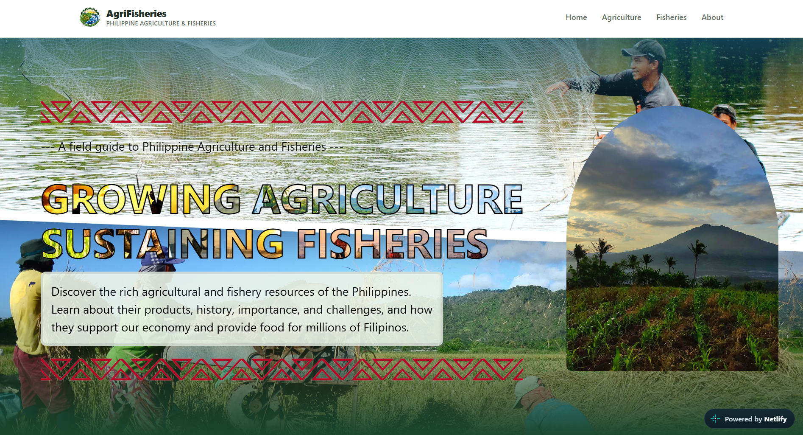

# 🌾 AgriFisheries

**AgriFisheries** is an informational website dedicated to showcasing the importance of agriculture and fisheries in the Philippines. It provides information about their contributions, different sectors, and the challenges they face.
This website was developed as part of our **Introduction to Computing (ITC)** subject at Batangas State University – Alangilan Campus.

## 📖 About the Project

Agriculture and fisheries play an important role in the Philippine economy and the daily lives of Filipinos. They provide food, employment, livelihood, and resources that support communities across the country.
The purpose of this website is to present information about these industries in an organized and accessible way, while helping users understand their importance to the Philippines.

## ✨ Features

- **Informational Content** – Provides information about Philippine agriculture and fisheries.
- **Organized Categories** – Separates topics into relevant categories and subcategories.
- **Visual Content** – Uses images to make information more engaging and easier to understand.
- **Responsive Design** – Designed to provide a better browsing experience across different screen sizes.
- **About Us** – Introduces the developers and the purpose of the website.

## 🛠️ Technologies Used

- HTML5
- CSS3
- JavaScript

## 🎯 Project Objectives

- Promote awareness of Philippine agriculture and fisheries.
- Provide accessible and informative content.
- Present important topics through a simple and organized website.
- Apply our knowledge of web development and design.

## 👥 Developers

- Comendador, Mark Daniel C.
- Canlas, Angelo Emmanuel I.
- Villianueva, Austin Kristeoff 
  **BSIT 1109 – Group Project**
  Batangas State University – The National Engineering University  
  Alangilan Campus

## 📌 Academic Information

- **Subject:** Introduction to Computing (ITC)
- **Course:** Bachelor of Science in Information Technology (BSIT)
- **Section:** BSIT 1109
- **Institution:** Batangas State University – Alangilan Campus

---

## 🖥️ Website Preview (Click the Image)

_Developed for educational purposes as part of our Introduction to Computing project._
